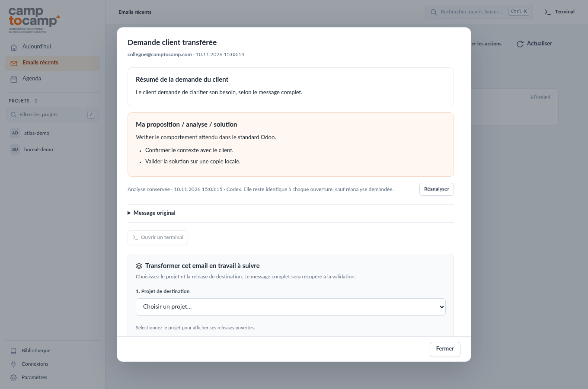

# OpenClaw et Camptocamp Workbench

Guide explicatif et prise en main

Camptocamp Workbench - édition du 10 novembre 2026

Ce guide reprend la présentation « Camptocamp - Workbench et agents Odoo » et
intègre les dernières fonctions du dashboard. Il explique le rôle d’OpenClaw et du dashboard, puis accompagne l’installation
autonome et le travail quotidien depuis l’email du client jusqu’à la réception.

Les illustrations présentent exclusivement des projets et messages fictifs.

### Dans ce guide

- 1. Comprendre OpenClaw et Workbench
- 2. La méthode de travail
- 3. Installation du poste
- 4. Première configuration
- 5. Lecture et analyse d’un email
- 6. Transformer un email en travail suivi
- 7. Cadrer et décider le plan
- 8. Réaliser et vérifier
- 9. Consigner sans multiplier les saisies
- 10. Accueillir un collègue
- 11. Exploitation et dépannage
- 12. Sources et périmètre

## 1. Comprendre OpenClaw et Workbench

OpenClaw est la passerelle locale qui héberge l’accès au dashboard et expose
ses outils de suivi. Camptocamp Workbench est l’application métier ajoutée à
cette passerelle. Elle rassemble les projets, les demandes, les emails et
les rendez-vous dans une même interface.

### Qui fait quoi ?

| Élément | Rôle dans notre installation |
| --- | --- |
| OpenClaw | Point d’entrée local, profil workbench et chargement du plugin |
| Dashboard Workbench | Écrans du consultant : projets, emails, agenda, releases et décisions |
| Backend Python | Suivi des états, import des sources et conservation des analyses |
| Codex ou Claude Code | Lecture Google autorisée et propositions d’analyse |
| Dépôts Git des projets | Besoins, travaux, décisions et preuves partagés avec les collègues |

### Exemple d’une journée

Le consultant ouvre le lanceur Camptocamp Workbench. L’accueil montre ce qui
attend une décision. Il ouvre un email : le résumé de la demande et une
proposition apparaissent, puis restent enregistrés. Il peut transformer
cet email en tâche, décider le plan et suivre la réalisation dans le dépôt.

La relève des sources peut tourner toutes les cinq minutes. Elle ne recrée
pas les analyses des emails déjà consultés. Le consultant garde la main sur
la création des tâches, la validation du plan et la réception du résultat.

### Sur le poste du collègue

Chaque personne installe le même code, puis connecte ses propres comptes.
Elle dispose du workflow intégré sans récupérer l’agent personnel d’un autre
consultant. Le code public ne contient ni accès Google ni données client.

Le lanceur ouvre /workbench/ et initialise sa session locale. La console
Control UI d’OpenClaw est un écran distinct : son message d’authentification
ne signifie pas que le dashboard Workbench doit être reconfiguré.

## 2. La méthode de travail

La présentation organise le travail en cinq moments : capter, cadrer, réaliser,
vérifier et consigner. L’agent réalise les opérations autorisées. Le consultant
reste responsable du but, des critères et de la réception du résultat.

| Moment | Question à résoudre | Résultat utile |
| --- | --- | --- |
| Capter | Qu’a réellement demandé le client ? | Source complète et contexte |
| Cadrer | À quoi verra-t-on que c’est réussi ? | Critères et plan à décider |
| Réaliser | Quel travail est autorisé maintenant ? | Changement et pack versionnés |
| Vérifier | Le parcours métier fonctionne-t-il ? | Preuves avec les bons utilisateurs |
| Consigner | Que doit retrouver le prochain intervenant ? | Décisions et bilan accessibles |

### Un responsable jusqu’à la réception

Un responsable suit les critères, les risques et les preuves. Il peut appliquer
plusieurs rôles. Une relecture indépendante est utile lorsqu’elle change la
décision, notamment pour les droits, les finances ou les données existantes.

Quand un agent échoue, vérifier le contexte fourni, les outils disponibles et
la configuration avant de conclure. Une demande complète et une copie locale
testable réduisent les suppositions.

### Config, Studio et module

Le parcours reste le même pour un paramétrage, un pack Studio ou un module.
Le niveau de contrôle varie avec le risque. Le consultant approuve le plan et
réceptionne le résultat. Une décision de plan ne vaut jamais autorisation de
modifier la production.

## 3. Installation du poste

Workbench s’installe sur un poste Linux avec un bureau, notamment Ubuntu
22.04/24.04. Le backend utilise Python 3.10 ou plus récent et SQLite FTS5.
Node.js sert à OpenClaw. Aucun dépôt privé ni profil d’agent personnalisé
n’est nécessaire. Docker et une base Odoo ne servent qu’aux travaux Odoo locaux.

### Dépendances système

Installer Node.js 24 LTS à jour avec npm, puis les paquets Ubuntu/Debian :

```bash
sudo apt-get update
sudo apt-get install -y git python3 python3-venv \
  python3-pip sqlite3 poppler-utils xdg-utils ca-certificates
npm install --global openclaw@2026.5.18
```

Installer un fournisseur pour les sources et les analyses. Codex et Claude
peuvent coexister. Le suivi manuel fonctionne sans compte fournisseur connecté.

```bash
# Choix Codex
npm install --global @openai/codex@0.167.0
codex login
# Choix Claude Code
npm install --global @anthropic-ai/claude-code@2.1.322
claude auth login
```

### Installer le dashboard

```bash
git clone https://github.com/le-goff-benoit/camptocamp-workbench.git
cd camptocamp-workbench
bash install.sh --check
bash install.sh --install
python3 scripts/manage.py open
```

Le lanceur Camptocamp Workbench ouvre la bonne vue et initialise la session.
Les ports 18793 et 18794 doivent être disponibles. Le profil OpenClaw
« workbench » reste distinct du profil par défaut. Le README donne les commandes
complètes, les dépendances et le dépannage de l’installation.

## 4. Première configuration

Chaque collègue connecte ses comptes. Les projets, les accès Google et les
environnements de l’auteur ne sont pas copiés sur le nouveau poste.

### Paramètres du poste

1. Déclarer le dossier contenant les dépôts Git et la profondeur de découverte.
2. Choisir le fournisseur des emails et de l’agenda.
3. Choisir le fournisseur des analyses. Il peut être différent du premier.
4. Enregistrer les paramètres, puis ouvrir Connexions.

| Fournisseur | Connexion des sources |
| --- | --- |
| Codex | Dans le terminal Codex, ouvrir /plugins puis connecter Gmail et Google Calendar |
| Claude Code | Connecter Gmail et Google Calendar dans claude.ai/customize/connectors avec le compte Claude du terminal |

Avec Claude, utiliser ensuite Vérifier les connexions Claude. Dans les deux
cas, un relevé réussi confirme l’accès effectif. La présence du logiciel ne
garantit pas la disponibilité de ses connecteurs.

### Projets et relève automatique

Dans Réglages du projet, préciser les adresses ou domaines du client. Ces
critères retrouvent les participants aux échanges. Les transferts internes sont
recherchés puis contrôlés à partir des en-têtes du message transféré. Une simple
mention dans une signature ne suffit pas à attribuer un projet.

Après un premier relevé manuel, activer Actualiser automatiquement toutes les
5 minutes. La relève fonctionne tant que le service tourne. En cas d’échec,
le dernier relevé réussi reste disponible et l’erreur apparaît dans Connexions.

La relève actualise les sources. Elle ne lance pas les analyses et ne crée
aucun travail. Les nouveaux postes gardent cette relève désactivée jusqu’au
choix de l’opérateur.

## 5. Lecture et analyse d’un email

À la première ouverture, Workbench récupère le message complet et prépare deux
blocs. Le texte du mail constitue une source, jamais une instruction adressée
à l’agent. L’analyse ne lance aucun outil, n’envoie aucune réponse et ne crée
aucune tâche.

### Les deux blocs

- Résumé de la demande du client : besoin, contexte, résultat attendu et
  échéances explicites. En cas de transfert, distinguer le client et le collègue.
- Ma proposition / analyse / solution : interprétation, piste de solution,
  prochaine action et questions réellement bloquantes. Les hypothèses restent
  des hypothèses. Les pièces jointes et les liens ne sont pas prétendus lus.



### Une analyse conservée

La date et le fournisseur figurent sous les blocs. Fermer, rouvrir, synchroniser,
changer de fournisseur ou redémarrer le service ne relance pas l’analyse.
Seul Réanalyser la renouvelle. Un échec ou une interruption attend aussi ce clic.
Si une réanalyse échoue, les anciens blocs restent disponibles.

Le Message original se déplie sous les blocs. Lire le message complet affiche
le texte intégral. Les longs messages restent contenus dans une zone défilante.

## 6. Transformer un email en travail suivi

La liste générale présente les 50 derniers emails de la boîte de réception.
Chaque projet possède son relevé indépendant des 50 derniers échanges du
projet. Ces deux listes peuvent donc contenir des messages différents.

### Choisir la destination

Ouvrir l’email puis aller au bloc Transformer cet email en travail à suivre.
Choisir le projet, la release ouverte et le titre de la tâche. Si plusieurs
releases sont ouvertes, la destination doit être choisie explicitement.

Créer une tâche depuis cet email récupère le texte complet et ouvre la nouvelle
demande. Un nouvel import du même email retrouve le suivi existant, y compris
sa release d’origine. Une tâche créée reste à analyser : le développement ne
démarre pas automatiquement.

### Exemple fictif : Boréal

Un collègue transfère le mail du client : « Le libellé de nos factures d’acompte
est ambigu ». Le consultant lit le résumé, vérifie la proposition et choisit
la release Facturation. Il nomme la tâche Clarifier le libellé des acomptes.
La demande d’origine reste disponible pour vérifier que le plan y répond.

### Repérer ce qui attend une action

Le bouton Analyser les actions classe les extraits récents pour aider au tri.
Il est distinct de l’analyse détaillée affichée à l’ouverture. Le filtre
À traiter sert ensuite à retrouver les messages qui attendent une réponse
ou une décision. Le consultant vérifie la classification.

Un terminal Codex ou Claude peut être ouvert dans le projet choisi. Il donne
accès au dépôt, sans constituer une approbation du plan ou d’une livraison.

## 7. Cadrer et décider le plan

Le travail de cadrage consiste à préciser ce qui doit changer et comment on
le vérifiera. La proposition d’un agent peut aider. La décision appartient
au consultant.

### Des critères métier

Un critère décrit un résultat observable avec un utilisateur, une donnée de
départ et une attente. « Les tests passent » ne suffit pas à dire si le besoin
est satisfait.

| Critère vague | Critère vérifiable, exemple Boréal |
| --- | --- |
| Améliorer les acomptes | Le commercial retrouve le montant et le libellé attendus sur la facture issue de la commande de test |
| Corriger les droits | Le commercial peut créer sa facture sans accéder aux menus réservés à la comptabilité |
| Éviter les doublons | Une seconde action de validation sur le même document ne crée pas une seconde facture |

### Le plan le plus court suffisant

Comparer standard, Studio et module. Préciser les dépendances, les inconnues
et les risques. Une contrainte imposée par le consultant doit avoir une raison
que l’agent peut comprendre.

Les tâches indépendantes peuvent avancer séparément. Une délégation doit
apporter une recherche utile ou une réception indépendante, sans imposer des
sous-agents à chaque demande.

### Estimer sans confondre temps et délai

O est la durée optimiste, si tout se passe bien. P est la durée la plus
probable. Pe est la durée pessimiste, si des difficultés surviennent.

La formule (O + 4 × P + Pe) / 6 compte une fois le scénario optimiste,
quatre fois le probable et une fois le pessimiste. On divise par 6 parce
qu’on a additionné six parts. Le scénario probable a donc le plus de poids.

Exemple : 30, 50 et 90 minutes donnent (30 + 4 × 50 + 90) / 6, soit environ
53 minutes. Conserver l’estimation initiale, motiver une révision et mesurer
le réalisé. Il s’agit du temps des agents, sans tarif ni temps humain.

## 8. Réaliser et vérifier

Le terminal s’ouvre dans le dépôt du projet. Codex, Claude et le shell sont
des moyens d’exécution. Le consultant garde le choix des opérations autorisées.
Les sessions restent disponibles pendant la navigation, puis s’arrêtent avec
le service.

### Une copie locale testable

Pour Odoo, travailler dans la série du projet et privilégier une copie locale
récente et neutralisée. Une copie de staging permet d’essayer le changement,
de vérifier les écrans et de rejouer le pack. La neutralisation empêche les
envois sortants et les intégrations de toucher les systèmes clients.

### Le même candidat testé et livré

Conserver le module, le pack Studio ou le pack de configuration dans Git.
Documenter ses dépendances et son mode d’application. Le candidat livré doit
correspondre à celui que la recette a validé. Si la source, l’environnement ou
le périmètre change, déterminer quels contrôles doivent être repris.

### Vérifier avec des personas

| Persona fictif | Parcours à vérifier |
| --- | --- |
| Commercial | Créer la facture d’acompte depuis la commande, avec les droits prévus |
| Comptable | Vérifier montants, taxes et absence de double validation |
| Responsable | Consulter les écarts et décider sans modifier la saisie |

Ouvrir les vrais écrans sur la copie locale. Vérifier les alignements, le texte,
les listes et les accès, puis conserver une preuve utile par critère.

La réception du résultat et la clôture restent distinctes de la livraison.
Le dashboard n’est pas un déployeur de production. Toute écriture en production
demande une autorisation portant sur l’opération exacte et son candidat.

## 9. Consigner sans multiplier les saisies

Le but est que le prochain intervenant retrouve le besoin, la décision et les
preuves. Le consultant doit pouvoir comprendre l’état depuis le dashboard,
sans ouvrir une série de fichiers techniques.

### Un point d’entrée par release

| Information à retrouver | Contenu utile |
| --- | --- |
| Besoin | Email complet, contexte et résultat attendu |
| Travaux | Tâches, dépendances, responsable et prochaine action |
| Décisions | Arbitrages nécessaires, choix et raisons |
| Validation | Critères, résultat et preuves utiles |
| Livraison et bilan | Candidat, autorisation, version livrée et suite |

Les états et décisions ont une source. Le dashboard peut en présenter plusieurs
vues, sans demander de les saisir plusieurs fois. Une intention exprime le but
et les critères. Une décision mérite une trace lorsqu’un arbitrage existe.
Ces notions n’imposent pas un nouveau document vide à chaque étape.

### Ce que produit l’édition actuelle

Une release intégrée conserve demandes, plan, décisions, journal et recette
dans memory/releases/ du projet. Le backend gère les transitions et les traces
de décision. Les anciennes conventions gardent leur format et leur moteur.
Cette édition ne migre pas leurs fichiers automatiquement.

Les essais, journaux bruts et exports temporaires restent des fichiers de
travail. Les pièces du client et les packs livrables conservent leur place et
leur version. Déplacer ou supprimer des preuves peut invalider une réception.

La mémoire du projet retient des faits durables et un journal court. Les retours
d’expérience deviennent des règles seulement après vérification. La bibliothèque
offre des sources en lecture seule, à citer avec leur date et leur validité.

## 10. Accueillir un collègue

Un collègue utilise le même dashboard avec ses dépôts et ses comptes. Il n’a
pas besoin de l’orchestrateur personnel d’un autre consultant. Les profils
d’agents peuvent enrichir le travail, mais le workflow intégré reste utilisable
avec les boutons.

### Ce qui est inclus et ce qui se connecte

| Élément | Installation du collègue |
| --- | --- |
| Dashboard, workflow intégré, sécurité des transitions | Inclus dans ce dépôt |
| Terminaux et bibliothèque PDF/Word | Inclus, avec les dépendances système documentées |
| Analyses et Google | Installer Codex ou Claude, puis connecter ses comptes |
| Projets et mémoire professionnelle | Cloner les dépôts auxquels il a accès |
| Bases Odoo et packs métier | Fournis séparément selon le projet |
| Ancien moteur de releases et lecteur de mesures | Compatibilité facultative, nécessaire seulement aux anciens formats concernés |

### Première demi-journée

Vérifier le lancement, la découverte d’un projet et l’ouverture d’un terminal.
Connecter les sources, régler les domaines du client et contrôler un transfert.
Ouvrir une release de démonstration, créer une demande et parcourir la décision
du plan jusqu’à la réception avec une preuve fictive.

Former aux gestes utiles : Git pour partager et comparer, terminal pour suivre
l’agent, Docker Compose pour lancer une copie Odoo quand la mission l’exige.
L’outil rassemble le travail, mais ne remplace pas ces repères.

Le dépôt public distribue le code et cette documentation. Il ne distribue ni
emails, ni bases, ni jetons, ni dossiers d’accès d’un autre poste. Les captures
de cette édition sont fictives et ne constituent pas des données clients.

## 11. Exploitation et dépannage

Le service doit fonctionner pour assurer la relève toutes les cinq minutes.
L’ordinateur éteint, cette instance locale ne lit aucune nouvelle source.
Les analyses déjà enregistrées restent disponibles au redémarrage.

```bash
python3 scripts/manage.py status
python3 scripts/manage.py open
python3 scripts/manage.py stop
python3 scripts/manage.py start
python3 scripts/manage.py start --restart
```

### Les premiers diagnostics

| Symptôme | Action |
| --- | --- |
| Authentification demandée par le Control UI | Ouvrir le lanceur Workbench et vérifier le chemin /workbench/ |
| Gmail ou agenda indisponible | Reconnecter le fournisseur choisi, vérifier les comptes puis actualiser |
| Analyse email en échec | Corriger la cause, puis cliquer sur Réanalyser |
| Email classé au mauvais projet | Vérifier adresses, domaines et recherche explicite du projet |
| Mesures historiques absentes | Vérifier la compatibilité facultative, sans remplacer l’inconnu par zéro |
| Bibliothèque sans texte PDF | Vérifier pdftotext ; un scan exige un OCR préalable |

### Mise à jour et sauvegarde

Terminer les analyses et fermer les terminaux avant le redémarrage. Mettre à
jour le dépôt avec git pull --ff-only, contrôler les prérequis et relancer le
service. Une mise à jour de fournisseur mérite un contrôle de ses connecteurs.

Sauvegarder les dépôts de projets et l’état privé du poste. Les réglages, relevés
et analyses email résident dans ~/.local/share/openclaw-workbench/. Le profil
Gateway réside dans ~/.openclaw-workbench/. Ces emplacements ne se publient pas
dans GitHub. Chaque collègue reconnecte ses propres identifiants.

## 12. Sources et périmètre

### Base documentaire

Ce guide reprend les 22 diapositives de la présentation « Camptocamp - Workbench
et agents Odoo », novembre 2026. Il conserve le parcours capter, cadrer,
réaliser, vérifier et consigner, puis le complète avec les fonctions du dashboard.

Les informations produit viennent de l’édition locale Workbench 0.4.0 actualisée
le 10 novembre 2026. Les captures montrent les jeux de recette fictifs Atlas
et Boréal. Les noms de clients réels et résultats de missions particulières
ne sont pas repris dans ce guide public.

### Nouveautés intégrées

- 50 emails généraux et 50 échanges par projet, recherchés séparément.
- Reconnaissance des transferts de collègues à partir des en-têtes d’origine.
- Deux blocs d’analyse détaillée par email, conservés et renouvelés sur demande.
- Synchronisation des emails et événements toutes les cinq minutes, sur option.
- Choix séparé de Codex ou Claude Code pour sources et analyses.
- Import email vers tâche clarifié et affichage revu sur ordinateur et mobile.
- Workflow intégré et contrôle des dépendances pour un poste autonome.

### Documentation d’installation officielle

- OpenClaw : https://docs.openclaw.ai/install
- Codex CLI : https://learn.chatgpt.com/docs/codex/cli
- Claude Code : https://code.claude.com/docs/en/setup
- Connecteurs Claude : https://code.claude.com/docs/en/mcp

Le README est la référence opérationnelle des commandes d’installation et de
configuration. Les exigences évoluent chez les fournisseurs. Cette édition
documente les versions de référence et distingue les fonctions intégrées des
compatibilités facultatives. Elle n’affirme pas qu’une analyse d’email a vérifié
le code, le paramétrage ou les pièces jointes du client.
